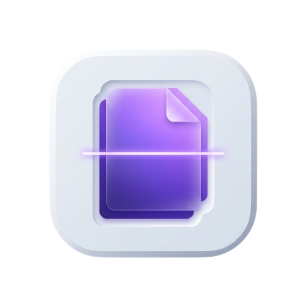
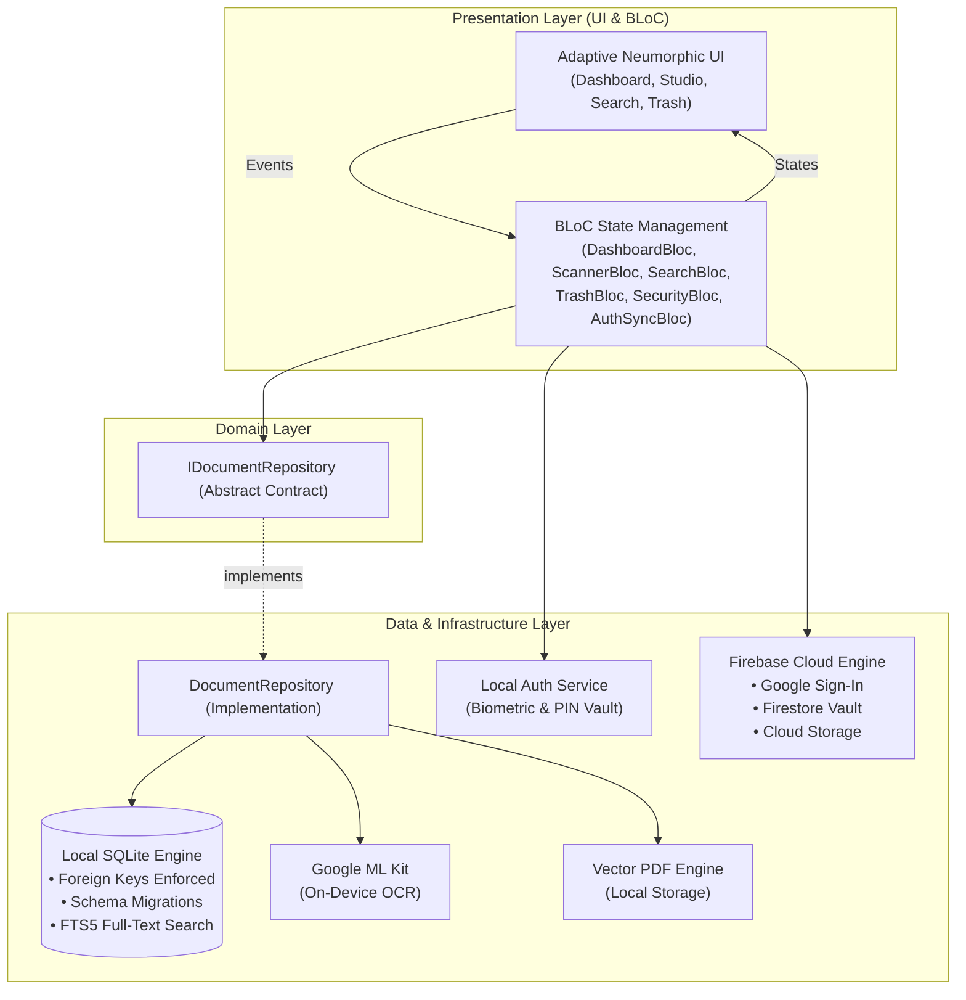

# Folio — The Offline Document Studio

<div align="center">



### Universal Offline Document Studio, Scanner & Vault

[](https://github.com/Aayush049/Folio/actions/workflows/ci.yml)
[](https://folio-doc-studio.web.app)
[](https://folio-nine-omega-50.vercel.app)
[](https://github.com/Aayush049/Folio/releases/download/v2.0.0/folio.apk)
[](https://flutter.dev)
[](https://dart.dev)
[](https://bloclibrary.dev)

**An offline-first document studio, on-device OCR engine, biometric privacy vault, and cross-platform scanner built with Flutter & Clean Architecture.**

[Live Web Demo](https://folio-doc-studio.web.app) • [Vercel Mirror](https://folio-nine-omega-50.vercel.app) • [Download Android APK](https://github.com/Aayush049/Folio/releases/download/v2.0.0/folio.apk) • [Architecture](#architecture--system-design) • [Key Features](#key-features) • [Tech Stack](#tech-stack) • [Getting Started](#getting-started)

</div>

---

## Overview

**Folio** is a production-grade cross-platform document studio engineered from the ground up on an **offline-first paradigm**. Unlike conventional scanning utilities that mandate cloud accounts or upload user data to remote servers, Folio ensures every captured document, optical text recognition (OCR) result, and signature remains 100% on the local device.

For users seeking seamless cross-device synchronization, Folio provides an **optional encrypted cloud vault** backed by Firebase Authentication, Cloud Firestore, and Cloud Storage with strict user-isolation security rules.

---

## Architecture & System Design

Folio strictly follows **Clean Architecture** principles, enforcing separation of concerns across Data, Domain, and Presentation layers, coupled with unidirectional data flow via BLoC.



### Architectural Pillars
- **Single Source of Truth**: Local SQLite (`sqflite` on mobile/desktop, `sqflite_common_ffi_web` via WebAssembly on web) is always the authoritative data source.
- **Dependency Inversion**: UI and BLoC layers depend strictly on abstract repository interfaces (`IDocumentRepository`), registered via `get_it` service locator (`sl`).
- **Defensive Error Handling**: Typed `Failure` hierarchy (`DatabaseFailure`, `OcrFailure`, `FileSystemFailure`, `SyncFailure`) eliminates silent failures and unhandled exceptions.

---

## Key Features

### 🔍 1. On-Device Full-Text OCR Search (SQLite FTS5)
- Search across the **actual textual content** of scanned documents, contracts, receipts, and invoices—not merely file titles.
- SQLite Full-Text Search (FTS5) inverted index automatically updates in real time upon page capture or text recognition.
- Debounced search screen with query snippets, contextual highlight previews, and keyword recommendations.

### 🔒 2. Hardware-Backed Biometric Vault & Privacy Shield
- Protect sensitive documents with Fingerprint, Face ID, or device PIN using `local_auth`.
- **Task-Switcher Privacy Shield**: Listens to app lifecycle states (`AppLifecycleState.paused / inactive`) to automatically blur and shield document previews in the OS task switcher.

### 🗑️ 3. Trash & Recovery (Soft Deletion)
- Defensive data protection: Deleting a document moves it to the recycle bin (`isDeleted = 1`, `deletedAt = timestamp`) rather than immediate disk deletion.
- Interactive undo toast on dashboard deletions.
- Dedicated Trash screen with single-tap "Restore" and permanent purge options.

### ☁️ 4. Optional Cloud Backup & Sync Engine
- Frictionless Google Sign-In integration.
- Encrypted cloud vault using Cloud Firestore and Firebase Storage.
- Declarative security rules (`firestore.rules` and `storage.rules`) enforcing strict user-level isolation (`request.auth.uid == userId`).
- 100% resilient: The app functions seamlessly when offline or without internet connectivity.

### 📱 5. Responsive Cross-Platform Design System
- Adaptive Neumorphic UI with ambient Day/Night lighting transitions.
- Responsive breakpoints (`FolioBreakpoints`): Smooth adaptation across mobile (<600dp), tablet (600–1024dp), and desktop/web (>1024dp).
- Desktop keyboard shortcuts (`Ctrl/Cmd+N` for new scan, `Ctrl/Cmd+S` to save, `Esc` to cancel).
- Tactile haptic feedback on key user actions.

---

## Tech Stack

| Layer | Technology | Function |
|---|---|---|
| **Framework** | Flutter (3.x) & Dart (3.x) | Cross-platform multi-target runtime |
| **State Management** | `flutter_bloc`, `equatable`, `provider` | Unidirectional reactive state machines |
| **Dependency Injection** | `get_it` | Decoupled service locator & repository wiring |
| **Local Database** | `sqflite`, `sqflite_common_ffi_web` | SQLite with FTS5 and WASM web worker |
| **OCR Recognition** | `google_mlkit_text_recognition` | On-device machine learning text extraction |
| **Security & Auth** | `local_auth`, `firebase_auth`, `google_sign_in` | Biometrics, PIN protection, and Google OAuth |
| **Cloud Vault** | `cloud_firestore`, `firebase_storage` | Remote metadata mirroring & image storage |
| **PDF Generation** | `pdf`, `open_filex` | High-resolution vector PDF compiling |
| **Testing & CI** | `flutter_test`, GitHub Actions | Automated CI pipeline with test coverage |

---

## Project Structure

```text
folio/
├── .github/
│   └── workflows/ci.yml         # GitHub Actions automated CI workflow
├── android/                     # Android native platform & ProGuard rules
├── ios/                         # iOS native platform configuration
├── web/                         # WebAssembly SQLite worker & PWA manifest
├── windows/                     # Windows native desktop runner
├── lib/
│   ├── blocs/                   # BLoCs (Dashboard, Scanner, Detail, Search, Trash, Security, AuthSync)
│   ├── core/                    # Breakpoints, shortcuts, theme notifier, and SQLite DatabaseHelper
│   ├── models/                  # Entity models (Document, Folder, PageModel, SearchResult)
│   ├── repositories/            # IDocumentRepository interface & implementation
│   ├── services/                # Scanner, PDF, Auth, Sync, and Security services
│   ├── ui/
│   │   ├── screens/             # Dashboard, Studio, Scanner, Detail, Search, Trash screens
│   │   └── widgets/             # Neumorphic components, shimmer loaders, privacy shield
│   └── main.dart                # Application bootstrap & dependency locator
├── test/                        # Automated unit, widget, and architecture test suite
├── firestore.rules              # User-isolated Cloud Firestore security rules
└── storage.rules                # User-isolated Firebase Storage security rules
```

---

## Getting Started

### Prerequisites
- [Flutter SDK](https://docs.flutter.dev/get-started/install) (`^3.11.5` or higher)
- [Dart SDK](https://dart.dev/get-dart)
- Android Studio / Xcode (for mobile builds)

### Installation & Execution

1. **Clone the repository:**
   ```bash
   git clone https://github.com/Aayush049/Folio.git
   cd Folio
   ```

2. **Install dependencies:**
   ```bash
   flutter pub get
   ```

3. **Run automated tests & static analysis:**
   ```bash
   flutter test
   flutter analyze
   ```

4. **Launch the application:**
   ```bash
   flutter run -d chrome     # Web
   flutter run -d android    # Android
   flutter run -d windows    # Windows Desktop
   ```

---

## Automated CI/CD Pipeline

Every push and pull request to `main` triggers our automated GitHub Actions workflow (`.github/workflows/ci.yml`):
- Sets up JDK 17 & Flutter stable environment.
- Validates code formatting (`dart format`).
- Performs static analysis (`flutter analyze --no-fatal-infos`).
- Executes the full automated test suite with coverage (`flutter test --coverage`).

---

## Author

Crafted by **Aayush** ([@Aayush049](https://github.com/Aayush049))
